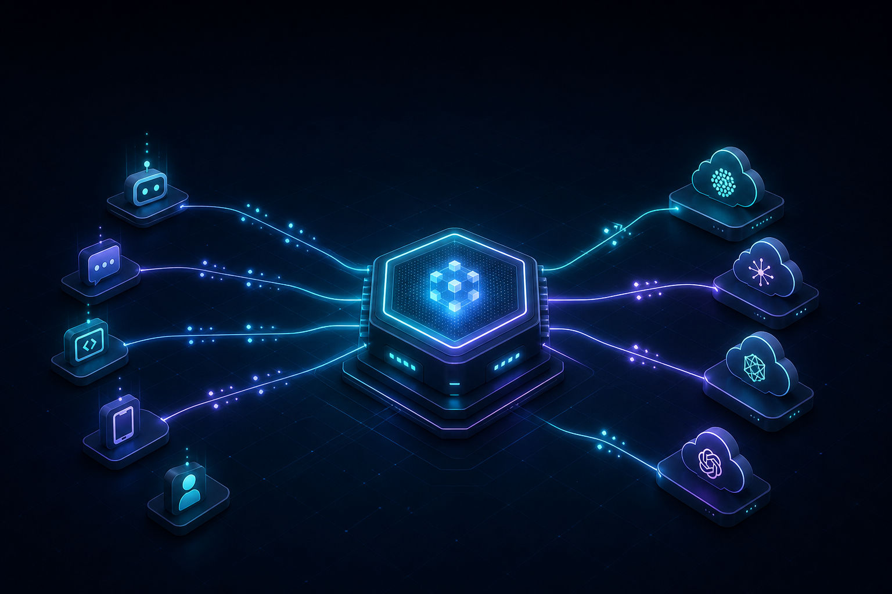
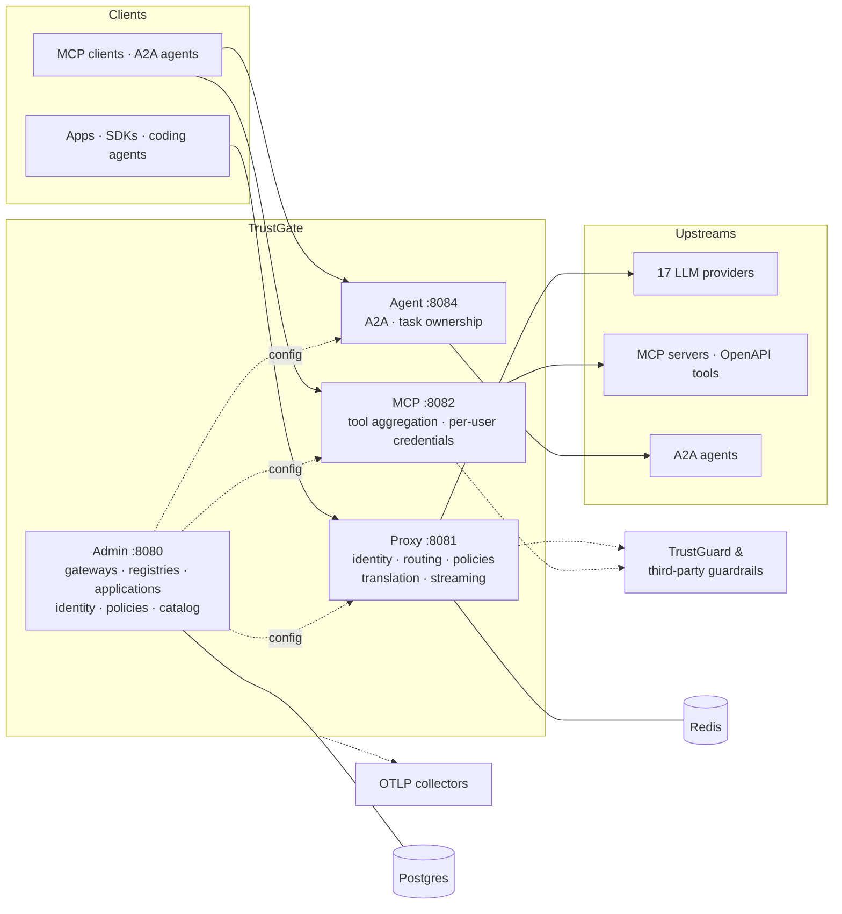

# TrustGate

TrustGate is an open-source AI gateway that routes, secures, and observes
traffic between applications, AI agents, LLM providers, MCP servers, and
other agents.

<div align="center">



**A security-first gateway for LLM, MCP, and agent-to-agent traffic, built in Go.**

[](https://pkg.go.dev/github.com/NeuralTrust/TrustGate)
[](https://goreportcard.com/report/github.com/NeuralTrust/TrustGate)
[](go.mod)
[](LICENSE)
[](https://github.com/NeuralTrust/TrustGate/actions/workflows/ci.yml)

[Documentation](https://docs.neuraltrust.ai/trustgate/overview) &nbsp;|&nbsp;
[Quick start](#quick-start) &nbsp;|&nbsp;
[Examples](examples/) &nbsp;|&nbsp;
[Architecture](#architecture) &nbsp;|&nbsp;
[Community](https://join.slack.com/t/neuraltrustcommunity/shared_invite/zt-2xl47cag6-_HFNpltIULnA3wh4R6AqBg)

</div>

---

## What it does

Applications, coding agents and autonomous agents call TrustGate instead of
calling providers, tool servers and other agents directly. TrustGate decides
who the caller is, where the call may go, which policies apply, and records what
happened.

| Traffic | Plane | What clients reach through it |
|---|---|---|
| **LLM** | Proxy `:8081` | 17 model providers, through the API dialect the client already speaks. |
| **MCP** | MCP `:8082` | Upstream MCP servers and OpenAPI services exposed as tools, aggregated behind one endpoint. |
| **Agents** | Agent `:8084` | Other agents over A2A (0.3 and 1.0), with pinned cards, task ownership and delegated identity. |

All three share one admin API (`:8080`), one identity model, one policy engine
and one telemetry pipeline.

## Highlights

- **Any client dialect, any provider.** OpenAI Chat Completions and Responses,
  Anthropic Messages, Gemini and Vertex AI, Cohere Chat and native Bedrock
  Runtime calls are translated to whichever provider serves the request,
  streaming included. Claude Code, Codex, the Gemini CLI and stock SDKs work
  by changing the base URL.
- **Routing that survives outages.** Simple routing, fallback chains with
  triggers and an attempt budget, smart routing across two or three ordered
  models that keeps a conversation on one and upgrades the harder turns, and
  load balancing (round-robin, weighted, least connections, random, semantic).
- **Identity built for agents.** One API key per application, external
  identity providers (Okta, Entra ID, any OIDC issuer) with client-id
  bindings and claim rules that keep people's tokens off agent routes, mTLS,
  personal keys, and end users named by the application.
- **Policies on the request path.** Rate limits and LLM budgets per
  application or per caller, model and tool allowlists, guardrails
  (TrustGuard, OpenAI Moderation, Azure Content Safety, Bedrock Guardrails,
  Google Model Armor, regex), prompt templates and compression, semantic cache.
- **Observability you can act on.** Per-gateway OTLP export, request traces with
  cost per call, an access log that names the authenticated caller, and records
  that join the client's own W3C trace.
- **Runs where your data must live.** One binary, one process per plane,
  Postgres and Redis. Data planes can run without a database, fed by the
  control plane over config sync.

### Safe by default

| Concern | Default |
|---|---|
| Client headers reaching providers | None. A registry lists the ones it forwards (`traceparent`, `tracestate`, …); credentials and gateway headers can never be listed. |
| Provider retries | None. Each retry is a billable call, and a timeout is never retried on the same backend. |
| A provider that fails mid-stream | The client gets an error event in its own dialect, never a truncated answer that looks complete. |
| Management API | Bind address and TLS are configurable (`SERVER_ADMIN_HOST`, `SERVER_ADMIN_TLS_*`). |
| Rate limits | Counted per application, or per verified caller; never per a header the client can rotate unless you choose so. |

---

## Quick start

### 1. Run it

```bash
curl -fsSL https://raw.githubusercontent.com/NeuralTrust/TrustGate/main/scripts/install.sh | bash
```

The script clones the repository, seeds `.env` (including `SERVER_SECRET_KEY`)
and starts Postgres, Redis and every plane with Docker Compose. From a clone,
`make up` does the same.

```bash
curl localhost:8080/healthz   # admin
curl localhost:8081/healthz   # LLM proxy
curl localhost:8082/healthz   # MCP
```

### 2. Make your first request

```bash
export OPENAI_API_KEY="sk-..."
./examples/curl-first-request/first-request.sh
```

It creates a gateway, registers OpenAI, creates an application with an API key,
and sends a chat completion through the proxy. The same steps by hand are in
[Admin API walkthrough](#admin-api-walkthrough).

### 3. Point your client at it

```python
from openai import OpenAI

client = OpenAI(
    base_url="http://localhost:8081/my-app/v1",
    api_key="<application API key>",
    default_headers={"X-AG-Gateway-Slug": "demo"},
)
client.chat.completions.create(model="gpt-4o-mini", messages=[{"role": "user", "content": "Hello"}])
```

More clients in [examples/](examples/): the OpenAI SDK in Python and
TypeScript, the Anthropic SDK, Go, and Cursor over MCP.

---

## Endpoints

Every path is relative to the application slug, `/{application}/...`.

| Path | Dialect |
|---|---|
| `/v1/chat/completions` | OpenAI Chat Completions |
| `/v1/responses` | OpenAI Responses |
| `/v1/messages` | Anthropic Messages |
| `/v2/chat` | Cohere Chat v2 |
| `/v1beta/models/{model}:generateContent`, `:streamGenerateContent` | Gemini (also the Vertex AI paths) |
| `/model/{model}/converse`, `/converse-stream`, `/invoke`, `/invoke-with-response-stream` | Native Bedrock Runtime |
| `/v1/embeddings`, Gemini `:embedContent` / `:batchEmbedContents`, Vertex `:predict` | Embeddings |
| `/v1/rerank` | Rerank |
| `/v1/images/generations`, `/edits`, `/variations` | Images |
| `/v1/audio/speech`, `/v1/audio/transcriptions` | Audio |
| `/v1/files` | Files |
| `/v1/models` | The models this application may call |

The [endpoint reference](https://docs.neuraltrust.ai/trustgate/endpoints/chat)
covers what each dialect keeps across providers.

---

## Architecture

The single binary runs one plane per process, so each scales on its own:

```bash
./trustgate              # LLM proxy (default)
./trustgate admin        # admin API, migrations, config sync
./trustgate mcp          # MCP plane
./trustgate agent        # A2A agent plane
./trustgate run          # admin + proxy in one process, for a single node
```



| Plane | Port | Responsibilities |
|---|---|---|
| **Admin** | `8080` | Gateways, registries, applications, identity providers, policies, catalog. Database migrations. Config sync to remote data planes. |
| **Proxy** | `8081` | Authentication, routing, policy stages, dialect translation, provider calls, streaming. |
| **MCP** | `8082` | MCP aggregation and the MCP Store, per-user upstream credentials and OAuth. See [docs/mcp/](docs/mcp/). |
| **Agent** | `8084` | A2A agents behind the gateway. See [docs/a2a.md](docs/a2a.md). |

A **data plane** (proxy and MCP) can run without Postgres, receiving its
configuration from the control plane over config sync and keeping a last-known-good
copy. That is how the hybrid and self-hosted deployments of the NeuralTrust
platform keep payloads in your cluster.

---

## Providers

| | | | |
|---|---|---|---|
| OpenAI | Anthropic | Azure OpenAI / Foundry | AWS Bedrock |
| Google AI Studio | Vertex AI | Mistral | Groq |
| DeepSeek | xAI | Cerebras | OpenRouter |
| Cohere | Moonshot AI | IBM watsonx.ai | DigitalOcean |
| Any OpenAI-compatible endpoint (vLLM, Ollama, LM Studio, …) | | | |

What each one needs is in [Model providers](https://docs.neuraltrust.ai/trustgate/registry/models).

## Policies

A policy is attached to applications, or to all traffic, and runs in ordered
stages before the request, before the response, and on the stream.

| Group | Policies |
|---|---|
| Traffic control | Rate Limiter, Request Size Limiter, Per-Tool Rate Limiter |
| Quota | LLM Budget (tokens or dollars, per application, per caller or per key) |
| Routing | Model Allowlist, Tool Allowlist, Semantic Cache |
| Prompt management | Prompt Template, Prompt Compression |
| Tool governance | Tool Injection |
| Guardrails | TrustGuard, OpenAI Moderation, Azure Content Safety, AWS Bedrock Guardrail, Google Model Armor, Regex Replace |
| Observability | Traffic Labels (classifies traffic, never blocks) |

Each policy can enforce, observe (a dry run that still records), or, for rate
limits, throttle. Reference: [Policies](https://docs.neuraltrust.ai/trustgate/policies/overview).

---

## Configuration

Everything is configured through environment variables; [`.env.example`](.env.example)
lists them all. The ones you are most likely to touch:

| Variable | Default | Purpose |
|---|---|---|
| `SERVER_ADMIN_PORT`, `SERVER_PROXY_PORT`, `SERVER_MCP_PORT`, `SERVER_AGENT_PORT` | `8080`–`8084` | Plane ports. |
| `SERVER_SECRET_KEY` | — | Signs admin tokens. At least 32 bytes. |
| `SERVER_ADMIN_HOST` | every interface | Bind the admin API to one address, such as `127.0.0.1`. |
| `SERVER_ADMIN_TLS_CERT_FILE`, `SERVER_ADMIN_TLS_KEY_FILE` | unset | Serve the admin API over HTTPS. |
| `DB_*`, `REDIS_*` | localhost | Postgres and Redis. |
| `PROVIDER_REQUEST_TIMEOUT` | `60s` | Upper bound on a provider call. |
| `PROVIDER_MAX_RETRIES` | `0` | Extra attempts on the same backend after a 5xx, 429 or transport error. |
| `OUTBOUND_ALLOW_PRIVATE_NETWORKS` | `true` | Set `false` when untrusted people can configure gateways, so they cannot aim TrustGate at your internal network. |
| `LOG_LEVEL`, `LOG_FORMAT` | `INFO`, `json` | At `INFO`, one `http access` line per request names the caller and both trace ids. |

## Observability

Each gateway exports a record per request to the OTLP collectors you configure:

```json
{
  "telemetry": {
    "exporters": [{
      "name": "my-collector",
      "type": "otlp",
      "settings": { "endpoint": "collector:4317", "protocol": "grpc" }
    }]
  }
}
```

A record carries the application, the caller, the model, tokens, cost and
latency. Raw-class exporters also get the payloads and the client's trace id as
the record's own trace context, so it shows inside the caller's trace. See
[`docs/telemetry/otlp-metadata-contract.md`](docs/telemetry/otlp-metadata-contract.md),
[`docs/pricing.md`](docs/pricing.md) for how cost is computed, and
[`config/telemetry.example.yaml`](config/telemetry.example.yaml).

---

## Local development

```bash
make compose-up      # Postgres and Redis in Docker
make run-admin       # terminal 1
make run-proxy       # terminal 2
make run-mcp         # terminal 3, optional
make run-agent       # terminal 4, optional

make test            # unit tests
make test-race       # unit tests with the race detector
make test-functional # the real binary against Postgres and Redis
make lint            # golangci-lint
make docs            # regenerate the Swagger and OpenAPI specs
```

See [CONTRIBUTING.md](CONTRIBUTING.md) for the full guide.

<details>
<summary><strong>Admin API walkthrough</strong></summary>

```bash
make up

ADMIN="http://localhost:8080"
PROXY="http://localhost:8081"
TOKEN="$ADMIN_TOKEN"   # see "Admin token" below

# 1. A gateway
GW=$(curl -s -X POST "$ADMIN/v1/gateways" \
  -H "Authorization: Bearer $TOKEN" -H "Content-Type: application/json" \
  -d '{"name":"My Gateway","slug":"demo"}')
GW_ID=$(echo "$GW" | jq -r .id); GW_SLUG=$(echo "$GW" | jq -r .slug)

# 2. An upstream provider
REG=$(curl -s -X POST "$ADMIN/v1/gateways/$GW_ID/registries" \
  -H "Authorization: Bearer $TOKEN" -H "Content-Type: application/json" \
  -d '{"name":"openai-primary","provider":"openai",
       "auth":{"type":"api_key","api_key":{"api_key":"'"$OPENAI_API_KEY"'"}}}')
REG_ID=$(echo "$REG" | jq -r .id)

# 3. An application that may use it
CON=$(curl -s -X POST "$ADMIN/v1/gateways/$GW_ID/consumers" \
  -H "Authorization: Bearer $TOKEN" -H "Content-Type: application/json" \
  -d '{"name":"my-app","registries":[{"id":"'"$REG_ID"'"}]}')
CON_ID=$(echo "$CON" | jq -r .id); CON_SLUG=$(echo "$CON" | jq -r .slug)

# 4. An API key, attached to the application
AUTH=$(curl -s -X POST "$ADMIN/v1/gateways/$GW_ID/auths" \
  -H "Authorization: Bearer $TOKEN" -H "Content-Type: application/json" \
  -d '{"name":"my-app-key","type":"api_key"}')
AUTH_ID=$(echo "$AUTH" | jq -r .id); API_KEY=$(echo "$AUTH" | jq -r .api_key)
curl -s -X POST "$ADMIN/v1/gateways/$GW_ID/consumers/$CON_ID/auths/$AUTH_ID" \
  -H "Authorization: Bearer $TOKEN"

# 5. A request through the proxy
curl -s -X POST "$PROXY/$CON_SLUG/v1/chat/completions" \
  -H "X-AG-Gateway-Slug: $GW_SLUG" -H "X-AG-API-Key: $API_KEY" \
  -H "Content-Type: application/json" \
  -d '{"model":"gpt-4o-mini","messages":[{"role":"user","content":"Hello!"}]}'
```

The gateway can also be named by host instead of the header:
`{slug}.<GATEWAY_BASE_DOMAIN>`.

### Admin token

The admin API takes a JWT (HS256) signed with `SERVER_SECRET_KEY`, carrying a
`tenant_id` or `"platform_admin": true`.

```bash
export SERVER_SECRET_KEY="$(grep ^SERVER_SECRET_KEY .env | cut -d= -f2-)"
export ADMIN_TOKEN=$(python3 - <<'PY'
import jwt, os, time
secret = os.environ["SERVER_SECRET_KEY"]
print(jwt.encode({"sub": "admin", "platform_admin": True, "iat": int(time.time()), "exp": int(time.time()) + 3600}, secret, algorithm="HS256"))
PY
)
```

The full reference is the [Admin API](https://docs.neuraltrust.ai/trustgate/api/credentials)
and the generated spec in [`docs/openapi.json`](docs/openapi.json).

</details>

## Repository layout

```
cmd/trustgate/        single binary: proxy | admin | mcp | agent | run
pkg/api/              HTTP handlers, middleware, request resolution
pkg/app/              application services: proxy, routing, plugins, MCP, A2A, auth
pkg/domain/           entities and ports
pkg/infra/            providers, plugins, persistence, telemetry, config sync
pkg/server/           servers and routers per plane
tests/functional/     end-to-end tests against the real binary
frontend/             a standalone admin dashboard
examples/             runnable client examples
docs/                 API specs and design notes
k8s/                  Kustomize bases and overlays
```

---

## FAQ

**How is TrustGate different from LiteLLM and other AI gateways?**
It is built by a security company, and assumes the gateway is where security is
enforced: identity, policy and audit come first, routing second. See the
comparisons below.

**Is it free?**
Yes. The gateway — LLM, MCP and A2A planes, routing, failover, caching and
policies — and its admin API are Apache 2.0. Paid tiers of the NeuralTrust
platform add the console, SSO and RBAC, audit logs, long retention, TrustGuard
detection, and managed or hybrid deployment.

**What is the difference between TrustGate and TrustGuard?**
TrustGate is the gateway: routing, policy and observability for LLM, MCP and
agent traffic. TrustGuard is the detection engine a TrustGate policy calls to
inspect prompts, responses and tool calls before they go on.

**Does it replace my API gateway?**
No. It governs AI traffic and sits alongside Kong, Apigee or AWS API Gateway.

**Is it production-ready?**
Yes. It runs NeuralTrust's own SaaS, NeuralTrust holds
[ISO 27001](https://neuraltrust.ai/news/neuraltrust-is-now-iso-27001-certified), and
it is listed in Gartner's 2025 Market Guide for
[AI Gateways](https://neuraltrust.ai/news/gartner-market-guide-for-ai-gateways).

**Can it run air-gapped?**
Yes. The gateway needs only Postgres, Redis and the providers you register.

## How TrustGate compares

- [The 10 best AI gateways for enterprise AI security in 2026](https://neuraltrust.ai/blog/best-ai-gateways)
- vs. [Kong](https://neuraltrust.ai/blog/neuraltrust-vs-kong) ·
  [LiteLLM](https://neuraltrust.ai/blog/neuraltrust-vs-litellm) ·
  [Portkey](https://neuraltrust.ai/blog/neuraltrust-vs-portkey) ·
  [Apache APISIX](https://neuraltrust.ai/blog/neuraltrust-vs-apache-apisix) ·
  [Solo.io agentgateway](https://neuraltrust.ai/blog/neuraltrust-vs-soloio-agentgateway) ·
  [HAProxy](https://neuraltrust.ai/blog/neuraltrust-vs-haproxy) ·
  [MLflow](https://neuraltrust.ai/blog/neuraltrust-vs-mlflow) ·
  [TrueFoundry](https://neuraltrust.ai/blog/neuraltrust-vs-truefoundry) ·
  [Google](https://neuraltrust.ai/blog/neuraltrust-vs-google)

---

## Contributing

Contributions are welcome: see [CONTRIBUTING.md](CONTRIBUTING.md), and
[`.github/GOOD_FIRST_ISSUES.md`](.github/GOOD_FIRST_ISSUES.md) for starter tasks.
New client examples in [`examples/`](examples/) are especially useful.

## License

Apache License 2.0 — see [LICENSE](LICENSE).

## Community and support

- [Documentation](https://docs.neuraltrust.ai)
- [Slack community](https://join.slack.com/t/neuraltrustcommunity/shared_invite/zt-2xl47cag6-_HFNpltIULnA3wh4R6AqBg)
- [GitHub issues](https://github.com/NeuralTrust/TrustGate/issues)
- [Twitter](https://twitter.com/neuraltrust)
- [Blog](https://neuraltrust.ai/en/resources/blog)

## Funding

<picture>
  <source media="(prefers-color-scheme: dark)" srcset="assets/funding/eic-funded-by-eu-white.png">
  
</picture>

Funded by the European Union. Views and opinions expressed are however those of the author(s) only and do not necessarily reflect those of the European Union or the European Innovation Council and SMEs Executive Agency (EISMEA). Neither the European Union nor the granting authority can be held responsible for them.

<div align="center">
Made with care by <a href="https://neuraltrust.ai">NeuralTrust</a>
</div>
